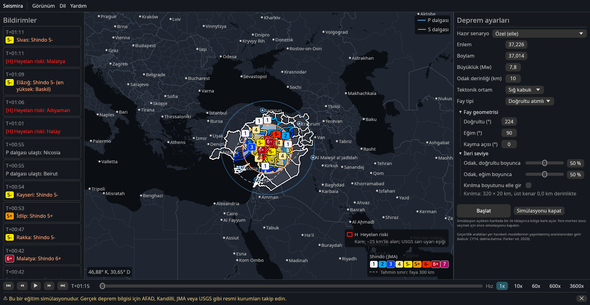
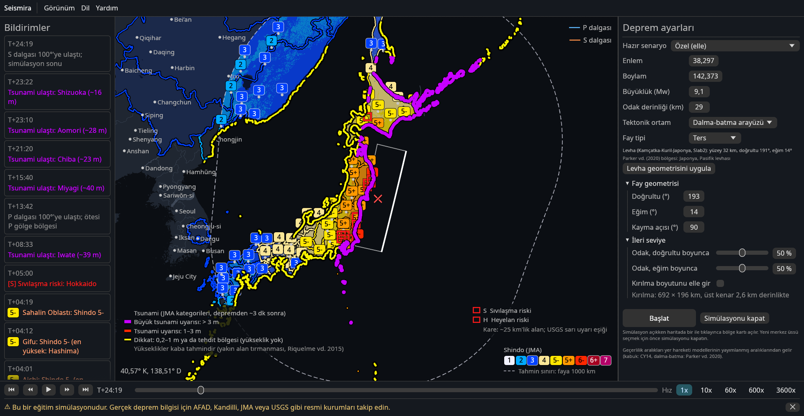

# Seismira

Dünya haritası üzerinde çalışan, eğitim ve farkındalık amaçlı, bilimsel
temelli deprem simülatörü. Haritada bir yere tıklayıp deprem tanımlarsınız
ya da hazır bir senaryo seçersiniz; P ve S dalgalarının yayılışını, şehir
ve il bazında şiddeti, erken uyarı sürelerini, tahmini bina hasarını,
sıvılaşma ve heyelan riskini ve tsunami tehlikesini canlı izlersiniz.
İnternet gerekmez.

An educational, science-based earthquake simulator on a world map. Click
anywhere (or pick a preset scenario) and watch P/S waves, city and
regional intensity, early-warning times, estimated building damage,
liquefaction and landslide hazard, and tsunami threat unfold. Works
offline.

> **Bu bir eğitim simülasyonudur.** Gerçek deprem bilgisi için AFAD,
> Kandilli, JMA veya USGS gibi resmi kurumları takip edin.
>
> **This is an educational simulation.** For real earthquake information,
> follow official agencies such as AFAD, Kandilli, JMA or USGS.





## Özellikler / Features

- **Sonlu fay modeli** (tek dikdörtgen düzlem); sığ kabuk, dalma-batma
  arayüzü ve levha içi depremler. Slab2 ile levha geometrisi önerisi.
  / Finite-fault source; crustal, interface and intraslab earthquakes.
- **Yer hareketi:** Chiou & Youngs (2014), Parker vd. (2020; bölgesel
  katsayılarla), ak135 seyahat süreleri, USGS Vs30 zemin haritası.
- **Şiddet:** JMA Shindo (0–7) ya da MMI (Worden vd. 2012), şehir
  kutuları, il / eyalet vurgusu, ±1σ belirsizlik aralığı.
- **Varsayımsal erken uyarı** (JMA ölçütü) ve bildirim akışı.
- **Bina hasarı:** Türkiye ve Avrupa için ESRM20 (hasar durumları);
  Japonya, ABD, Meksika ve dünya için isteğe bağlı GEM paketi (ortalama
  hasar oranı).
- **Zemin yenilmesi:** sıvılaşma (Zhu vd. 2017) ve heyelan (Nowicki
  Jessee vd. 2018), USGS sarı uyarı eşiğiyle ~25 km'lik kareler.
- **Tsunami:** Okada (1985) taban deformasyonu, fast marching varış
  süreleri, yakın alan tırmanması (Riquelme vd. 2015), JMA kategorileriyle
  kıyı şeridi.
- **8 hazır senaryo** (doğrulama depremleri): 2023 Kahramanmaraş, 1999
  İzmit, 2016 Kumamoto, 2019 Ridgecrest, 2011 Tōhoku, 2024 Noto, 2010
  Maule, 2017 Puebla.
- Türkçe ve İngilizce arayüz, çok yazı sistemli metin (Noto yazı
  tipleri), "hareketi azalt" ayarı, WCAG AA kontrastı, kalite ayarı.

Her formül yayımlanmış kaynağından alınır ve birim testiyle denetlenir;
sonuçlar gerçek depremlerle karşılaştırılır (`docs/dogrulama.md`).
Every formula comes from its published source with unit tests; results
are validated against real earthquakes (`docs/dogrulama.md`).

Durum: ilk sürüm **v0.1.0** yayımlandı (2026-11-23). Geliştirme sürüyor.
Status: first release **v0.1.0** is out (2026-11-23). Development
continues.

## İndirme / Download

Hazır paketler (Windows, macOS Apple Silicon / Intel, Linux):
[Sürümler / Releases](https://github.com/Kamtasyaa/seismira/releases/latest)
(her biri ~690 MB, açılınca ~730 MB). Arşivi açıp `seismira` dosyasını çalıştırmanız
yeterli; ayrıntılar arşivdeki `KURULUM.txt` dosyasında.

Uygulama **imzasızdır** (kod imzalama ücretli): Windows'ta "Ek bilgi →
Yine de çalıştır", macOS'ta Sistem Ayarları → Gizlilik ve Güvenlik →
"Yine de Aç".

Prebuilt packages for Windows, macOS and Linux are on the
[Releases](https://github.com/Kamtasyaa/seismira/releases/latest) page
(~690 MB each). The app is **unsigned**: on Windows choose "More info → Run
anyway"; on macOS use System Settings → Privacy & Security → "Open
Anyway". See `KURULUM.txt` in the archive.

## Kaynaktan derleme / Build from source

```bash
python3 scripts/prepare_data.py   # veri (bir kez) / data (once)
cargo run --release -p seismira-app
```

Zemin yenilmesi katmanları için (büyük indirme, ~3,6 GB) / for the ground
failure layers (large download): `python3 scripts/prepare_data.py --ground`.
GEM paketi (CC BY-NC-SA, ticari kullanım yok) / GEM package:
`python3 scripts/prepare_data.py --gem`. Dağıtım veri paketi / release
data bundle: `python3 scripts/package_data.py <sürüm>`.

## Veri talepleri / Data requests

Bazı veri setleri açıkça yeniden dağıtılabilir değil. Kurumlardan izin ya
da veri istendi; yanıt gelene kadar bu veriler yalnızca yerelde
kullanılır, uygulamayla dağıtılmaz.

Some datasets are not openly redistributable. Permission or data was
requested from the institutions below; until they reply, such data is
used locally only and is not shipped with the app.

| Kurum / Institution | Ne için / Purpose | Durum / Status |
|---|---|---|
| PEER, UC Berkeley (NGA-West2) | Ölçülmüş kayıtlarla CY14 doğrulaması / CY14 validation with recorded ground motions | Kayıt izni verildi; yeniden dağıtım sorusu yanıtsız / Registration approved; redistribution question unanswered |
| Universidade de Santiago de Compostela (Fan vd. yeraltı su seviyesi) | Sıvılaşma (Zhu 2017 genel model) / Liquefaction (general model) | İzin bekleniyor; dağıtılan sürümde kıyı modeli / Pending; shipped build uses the coastal model |
| Universität Hamburg (GLiM vektör litoloji) | Heyelan / Landslides | İzin istendi (2026-11); dağıtılan sürümde açık lisanslı 0,5° GLiM (CC BY 3.0) / Requested; shipped build uses the open 0.5° GLiM |
| Kandilli Rasathanesi, Düzce Üniv., İTÜ, ODTÜ EERC, DEÜ | Türkiye verileri (kayıtlar, zemin) / Turkish data (records, site) | İstendi; yanıt bekleniyor / Requested; pending |
| NIED J-SHIS (Japonya) | Zemin verisinin (Vs30) kullanım teyidi / Confirmation of site data use | Kullanım koşulları izin veriyor; teyit istendi / Terms allow use; confirmation requested |

Japonya'daki diğer veriler (JMA, e-Stat) Devlet Standart Kullanım
Koşulları (CC BY 4.0 uyumlu) ile yayımlanıyor; izin gerekmez.
Other Japanese data (JMA, e-Stat) is published under the Government
Standard Terms of Use (CC BY 4.0 compatible); no permission needed.

Ayrıntılar ve lisanslar / Details and licences: `docs/veri.md`,
`data/SOURCES.toml`, uygulamada / in the app: Yardım → Veri kaynakları ve
lisanslar / Help → Data sources and licenses.

## Lisans / License

Kod: GPL-3.0-or-later (bkz. `LICENSE`). Veriler kendi lisanslarıyla
dağıtılır; ayrıntı `data/SOURCES.toml` ve `docs/veri.md`. GEM paketiyle
dağıtılan sürüm satılamaz (CC BY-NC-SA).

Code: GPL-3.0-or-later (see `LICENSE`). Data is distributed under its own
licences; see `data/SOURCES.toml` and `docs/veri.md`. Builds bundled with
the GEM package may not be sold (CC BY-NC-SA).
